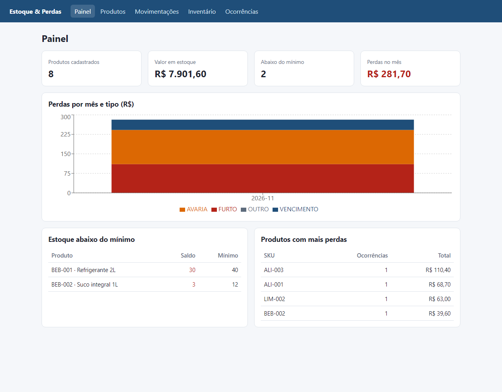
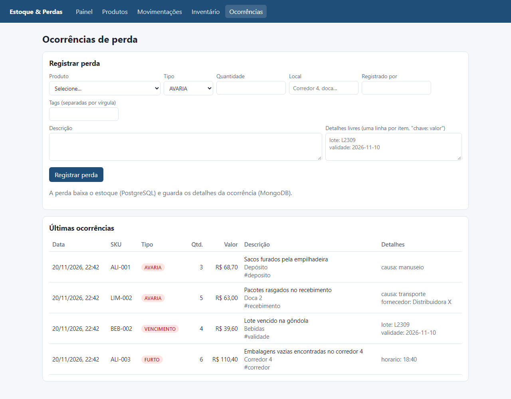

# Controle de Estoque e Perdas

Sistema web para controlar o estoque de uma loja e registrar **perdas** (furto, avaria, vencimento), com inventário de contagem física e um painel com o valor perdido por mês.

A ideia veio da minha experiência como supervisor de almoxarifado e de prevenção de perdas no varejo: o saldo do sistema raramente bate com o físico, e é preciso saber **quanto** se perdeu, **por quê** e **onde**.



## Funcionalidades

- **Produtos**: cadastro com SKU, custo unitário e estoque mínimo; busca e filtro de itens que precisam de reposição.
- **Movimentações**: entradas e saídas com histórico. O saldo só muda por movimentação e **nunca fica negativo**, nem com pedidos simultâneos.
- **Inventário**: ao abrir, o sistema guarda o saldo de cada produto. Depois da contagem física, mostra a acurácia, as faltas e as sobras em R$, e no fechamento gera um **ajuste** para cada divergência.
- **Ocorrências de perda**: baixam o estoque e guardam os detalhes do caso (local, tags e campos livres, como lote e validade).
- **Painel**: valor em estoque, perdas do mês, gráfico de perdas por mês e tipo, produtos abaixo do mínimo e produtos com mais perdas.



## Tecnologias

| Camada | Tecnologias |
|---|---|
| Front-end | React 19, TypeScript, React Router, Recharts, Vite |
| Back-end | Node.js, Express 5, TypeScript, Zod (validação) |
| Bancos de dados | PostgreSQL (estoque) e MongoDB (ocorrências) |
| Testes | Vitest e Supertest, com bancos reais |
| Infraestrutura | Docker, Docker Compose, Nginx, GitHub Actions |

## Arquitetura

```
React (Nginx :8080) ──/api──▶ API Express (:3333) ──▶ PostgreSQL  produtos, movimentações, inventários
                                                   └─▶ MongoDB     ocorrências de perda
```

**Por que dois bancos?** Estoque é um dado estruturado que precisa de consistência: saldo, histórico e inventário ficam no PostgreSQL, com transações e restrições (`CHECK current_stock >= 0`). Já cada ocorrência de perda tem um formato diferente (um furto tem local e horário; um vencimento tem lote e validade). Esses dados livres ficam no MongoDB, sem precisar de uma coluna nova para cada tipo.

**Como os dois bancos ficam consistentes:** ao registrar uma perda, a API abre uma transação no PostgreSQL, baixa o estoque, grava a ocorrência no MongoDB e só então faz o `COMMIT`. Se o MongoDB falhar, a transação é desfeita e o estoque não muda. Há um teste automatizado para esse caso.

**Estoque nunca negativo, mesmo com acessos simultâneos:** a baixa é um único `UPDATE ... WHERE current_stock + delta >= 0`. Assim, a checagem e a alteração acontecem no mesmo comando, e duas saídas ao mesmo tempo não conseguem passar do saldo. Um dos testes dispara 5 saídas simultâneas para provar isso.

## Como rodar

### Com Docker (recomendado)

```bash
docker compose up --build
```

- Sistema: http://localhost:8080
- API: http://localhost:3333/api/health

Para carregar dados de exemplo:

```bash
docker compose exec api node dist/db/seed.js
```

### Em modo de desenvolvimento

Requisitos: Node.js 22+ e Docker (para os bancos).

```bash
docker compose up -d postgres mongo

cd api
cp .env.example .env
npm install
npm run seed      # cria as tabelas e os dados de exemplo
npm run dev       # API em http://localhost:3333

cd ../web
npm install
npm run dev       # front em http://localhost:5173
```

### Testes

Com os bancos rodando:

```bash
cd api
npm test
```

São 17 testes: os unitários cobrem o cálculo de divergências, e os de integração cobrem a API com PostgreSQL e MongoDB reais. Eles usam um banco separado (`estoque_test`), então não apagam os dados de desenvolvimento. O GitHub Actions roda os testes, a checagem de tipos e o build a cada push.

## Endpoints da API

| Método | Rota | Descrição |
|---|---|---|
| GET | `/api/products?search=&lowStock=true` | Lista produtos |
| POST | `/api/products` | Cadastra produto |
| PATCH | `/api/products/:id` | Edita dados do produto (não o saldo) |
| GET | `/api/movements?productId=` | Histórico de movimentações |
| POST | `/api/movements` | Entrada ou saída |
| POST | `/api/inventories` | Abre inventário |
| PUT | `/api/inventories/:id/items/:productId` | Registra a contagem de um produto |
| POST | `/api/inventories/:id/close` | Fecha e gera os ajustes |
| GET | `/api/occurrences?type=&tag=` | Lista ocorrências |
| POST | `/api/occurrences` | Registra perda |
| GET | `/api/inventories/:id` | Detalhe com resumo das divergências |
| GET | `/api/dashboard` | Indicadores do painel |

## Estrutura

```
api/
  src/
    modules/        uma pasta por assunto (rotas + regras de negócio)
    db/             conexões, migrações SQL e dados de exemplo
    middlewares/    tratamento de erros
  tests/
web/
  src/pages/        uma tela por arquivo
docker-compose.yml
```

## Próximos passos

- Login com perfis (operador e supervisor)
- Fotos anexadas às ocorrências
- Exportar relatórios de perdas em CSV

## Autor

**Júlio Falcão**, desenvolvedor Full Stack · [LinkedIn](https://www.linkedin.com/in/juliofalcao-dev)
